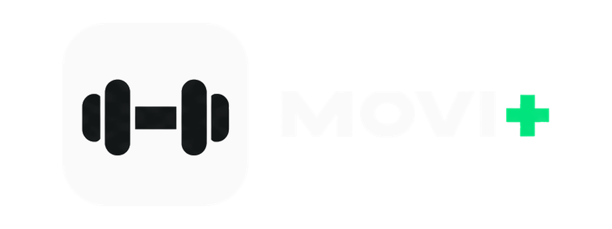

# MOVI+



Plataforma acadêmica de academia comunitária voltada à atividade física, à acessibilidade e à conexão entre praticantes e profissionais. O MOVI+ organiza o cadastro de usuários, a biblioteca de exercícios e o planejamento e registro de treinos em uma aplicação web reproduzível com Docker e MySQL.

Projeto desenvolvido na disciplina Prática IV de Ciência da Computação da UNOESC, em 2026.

## Sumário

- [Funcionalidades](#funcionalidades)
- [Stack](#stack)
- [Estrutura do projeto](#estrutura-do-projeto)
- [Executando com Docker](#executando-com-docker)
- [Desenvolvimento local](#desenvolvimento-local)
- [Banco de dados, migrations e seeds](#banco-de-dados-migrations-e-seeds)
- [Biblioteca de exercícios](#biblioteca-de-exercícios)
- [Testes e qualidade](#testes-e-qualidade)
- [Variáveis de ambiente](#variáveis-de-ambiente)
- [Segurança](#segurança)
- [Solução de problemas](#solução-de-problemas)
- [Equipe](#equipe)
- [Licença](#licença)

## Funcionalidades

| Situação | Recursos |
|---|---|
| Implementadas | Cadastro e login; cadastro profissional; gerenciamento de alunos e solicitações/vínculos; biblioteca pública e exercícios personalizados; pesquisa, filtros e detalhes; criação, edição, arquivamento e restauração de rotinas; configuração de séries, repetições, cargas e descanso; execução de sessões e treinos livres; histórico paginado e estatísticas de evolução. |
| Parciais | A mídia aparece quando existe cadastro válido de imagem ou GIF. O descanso tem alerta visual enquanto a página está aberta. Rascunhos pendentes sobrevivem a falhas na mesma aba, mas não há sincronização offline depois de fechá-la. |
| Planejadas | Recomendações automáticas, gamificação com ranking e conquistas, espaços públicos e recursos ampliados de comunidade e acessibilidade. |

## Stack

| Camada | Tecnologia | Uso |
|---|---|---|
| Aplicação | PHP 8.3, Apache, Composer 2 | Aplicação sem framework; Composer fornece autoload PSR-4 para `App\\`. |
| Persistência | MySQL 8.4, PDO | Banco relacional e consultas parametrizadas. |
| Interface | HTML, CSS, JavaScript | Views PHP, estilos e interação do catálogo e treinos. |
| Infraestrutura | Docker, Docker Compose v2 | Serviços `app` e `db`; versões de ferramentas instaladas nos containers. |

`public/index.php` direciona método e caminho conforme [routes/web.php](routes/web.php). Controllers recebem requisições, services concentram regras, repositories consultam o banco e as views geram a interface. O Apache publica somente `public/`.

## Estrutura do projeto

```text
MOVI+/
├── .docker/php/       # Dockerfile e configurações PHP/Apache
├── app/
│   ├── Config/        # Conexão PDO
│   ├── Controllers/   # Fluxo HTTP
│   ├── Models/        # Entidades
│   ├── Repositories/  # Consultas e persistência
│   ├── Security/      # Sessão, autenticação, CSRF e limite de login
│   ├── Services/      # Regras e operações de treino
│   └── Views/         # Templates PHP
├── assets/            # Logotipo e imagens do projeto
├── database/
│   ├── migrations/    # 001–016, evolução do schema
│   ├── scripts/       # Migrador, importação e validação do catálogo
│   └── seeds/         # 37 arquivos SQL de dados oficiais e relações
├── public/
│   ├── assets/        # CSS, JavaScript e imagens públicas
│   ├── .htaccess      # Regras de entrada do Apache
│   └── index.php      # Front controller
├── routes/            # Mapa de rotas
├── storage/           # Diretórios locais de uploads, sessões e logs
├── tests/             # Testes permanentes HTTP e de integração
├── compose.yml        # Serviços de desenvolvimento
├── composer.json      # Autoload da aplicação
└── README.md          # Documentação operacional única
```

## Executando com Docker

### Pré-requisitos

- Git.
- Docker Desktop com backend WSL 2 no Windows, ou Docker Engine e plugin Docker Compose no Linux/macOS.
- Contêineres Linux habilitados. No Windows, confirme WSL 2 com `wsl --status` e aguarde o Docker Desktop iniciar.
- Compose v2 com suporte a `up --wait`.

PHP, MySQL e Composer no host não são necessários.

### Instalação limpa

Clone o projeto e crie o arquivo de ambiente local:

```sh
git clone https://github.com/MiguelBrugnago/MOVI-MORE.git
cd MOVI-MORE
cp .env.example .env
```

No PowerShell, use `Copy-Item .env.example .env`. Edite `.env` e troque os dois valores de exemplo por senhas locais diferentes. Mantenha `.env` privado; ele não deve ser versionado.

Suba o MySQL, instale dependências, aplique as migrations, importe o catálogo e inicie o Apache:

```sh
docker compose up -d --wait db
docker compose run --build --rm --no-deps app composer install --optimize-autoloader --no-interaction
docker compose run --rm --no-deps app php database/scripts/migrar.php
docker compose run --rm --no-deps app php database/scripts/popular_exercicios.php
docker compose up -d --wait app
docker compose ps
```

Abra [http://localhost:8080](http://localhost:8080). Crie uma conta para verificar cadastro e login, pesquise um exercício e confira seus detalhes. Em **Rotinas e treinos**, crie uma rotina, inclua um exercício e configure uma série; inicie e finalize uma sessão e confira o Histórico e Evolução.

O MySQL é criado com o schema e o usuário definidos no primeiro boot de um volume vazio. Apache não aplica migrations nem seeds automaticamente. O volume `movi_mysql_data` persiste mesmo quando containers são removidos.

## Desenvolvimento local

Abra a raiz do clone no VS Code por **Arquivo → Abrir Pasta**. O serviço `app` monta a pasta do projeto em `/var/www/html`, então alterações em PHP, CSS e JavaScript ficam visíveis após salvar; OPcache revalida timestamps. Para dependências Composer ou comandos PHP, use o container:

```sh
docker compose exec app php -v
docker compose exec app composer validate --no-check-publish
docker compose exec app composer check-platform-reqs
docker compose logs --tail=100 app db
```

Comandos úteis:

```sh
docker compose ps
docker compose stop                 # para sem apagar dados
docker compose up -d --wait         # retoma os serviços
docker compose logs -f app
docker compose exec db sh           # shell do container MySQL
```

Para atualizar o clone, confira suas alterações locais, obtenha as mudanças da equipe e leia as instruções de atualização de banco nesta documentação antes de executar migrations. Trabalhe em branch própria baseada na `main` atualizada, mantenha mudanças relacionadas juntas e revise `git status --short`, `git diff --check` e o diff staged antes de cada commit. Não coloque `.env`, dados de usuário ou backups nos commits.

## Banco de dados, migrations e seeds

O banco usa MySQL 8.4, `utf8mb4` e PDO. No Compose, o host de conexão da aplicação é `db` e a porta interna é `3306`; ferramentas no host acessam `127.0.0.1:3307`. O schema reúne usuários, autenticação e vínculos, catálogo/taxonomias e relações, rotinas reutilizáveis e execuções de treino.

### Histórico de migrations

O repositório possui migrations sequenciais **001–016**:

| Faixa | Conteúdo |
|---|---|
| 001–006 | Estrutura inicial, hash de senhas, tentativas e bloqueios de login, evento de limpeza e origem dos vínculos. |
| 007–009 | Histórico do catálogo: expansão de padrões/famílias e simplificação posterior que remove essas estruturas e cria índice de login. A sequência histórica é preservada. |
| 010–014 | Integridade do catálogo, unidades, códigos e reconciliação/prefixo MOVI+. |
| 015 | Rotinas e execução: séries, descanso, metas copiadas, métricas e índices. |
| 016 | Ajuste do evento de limpeza de tentativas para calcular o corte usando o relógio do MySQL. |

Execute o migrador pela aplicação:

```sh
docker compose run --rm --no-deps app php database/scripts/migrar.php
```

O script exige numeração contígua, adquire lock MySQL, salva cada etapa em `schema_migracao` e valida SHA-256 dos SQL com finais de linha normalizados. Um registro em `em_execucao`, checksum divergente ou histórico fora de sequência interrompe a execução. DDL do MySQL pode fazer commit implícito; depois de interrupção, confira estrutura e histórico antes de qualquer retomada. Não apague registros para forçar a execução.

Uma instalação sem histórico em schema já preenchido é recusada. A opção antiga `--adotar-instalacao` não existe mais. Para um legado já confirmado até 015, compare estrutura, eventos e catálogo com uma cópia limpa e faça backup antes de registrar a atestação:

```sh
docker compose run --rm --no-deps app php database/scripts/migrar.php --registrar-historico
```

Isso grava hashes como referência declarada pelo operador; não verifica retroativamente quais SQL foram executados. O migrador não executa migrations nesse modo e exige as 001–015 confirmadas. Legados parciais sem hashes ou anteriores à transição 009 precisam de recuperação planejada em cópia isolada.

Em uma instalação antiga, o evento `limpar_tentativas_login` pode pertencer a outra conta, como `root@localhost`. A 016 exige `DEFINER` igual à conta efetiva da aplicação. Confira `information_schema.EVENTS.DEFINER` e `SELECT CURRENT_USER()` usando a conexão do app. Se diferirem, peça a um administrador para transferir somente o evento antes da migration; confirme schema e usuário reais. Exemplo ilustrativo para schema `movi` e conta `movi_app@%`:

```sql
ALTER DEFINER = 'movi_app'@'%' EVENT movi.limpar_tentativas_login ENABLE;
```

Não conceda privilégios de sistema à conta do PHP para contornar isso.

### Seeds

Há **37 arquivos SQL** em `database/seeds/`. `popular_exercicios.php` os aplica em ordem alfabética, dentro de uma transação, e confirma que existe catálogo público ativo. As seeds estabelecem taxonomias e registros, exercícios e relações, aliases, slugs, ambientes e hierarquia muscular. Elas preservam códigos estáveis e não repetem a conversão histórica executada pela 014. Dados de contas e exercícios personalizados não são recriados pelas seeds.

Para conferir migrations e catálogo:

```sh
docker compose exec db sh -c 'mysql -u "$MYSQL_USER" -p "$MYSQL_DATABASE"'
```

```sql
SELECT arquivo, aplicada_em FROM schema_migracao ORDER BY arquivo;
SHOW TABLES;
SELECT COUNT(*) AS total,
       SUM(ativo = 1) AS ativos,
       SUM(ativo = 0) AS inativos,
       COUNT(DISTINCT codigo) AS codigos
FROM exercicio
WHERE usuario_id IS NULL;
```

`database/scripts/validar_catalogo.sql` verifica campos, taxonomias, duplicações e relações órfãs. `database/scripts/assinatura_catalogo.sql` produz assinatura SHA-256 de cada registro público e de suas relações, ignorando IDs internos e datas para permitir comparar instalações. Compare a saída completa entre origem e destino; totais iguais não provam que o catálogo é idêntico. Uma validação anterior registrou 629 exercícios públicos (623 ativos e 6 inativos); confirme novamente na instalação que está sendo verificada antes de usar esse número como resultado atual.

### Instalação existente e recuperação

Antes de atualizar banco existente, faça backup restaurável incluindo estrutura, dados e eventos; teste a restauração numa instância e schema separados. Não altere `.env` esperando que o MySQL atualize senhas já persistidas no volume. Compare o estado de migrations; não reimporte catálogo já existente sem entender o efeito das seeds. Se atualizar um legado para a 016, aplique a regra do `DEFINER` acima.

Backups podem conter dados pessoais e credenciais. Guarde-os somente em `storage/backups/`, que é ignorado pelo Git, e proteja o acesso. Uma exportação de recuperação pode ser feita assim (PowerShell 7.4+ para preservar bytes do redirecionamento):

```powershell
New-Item -ItemType Directory -Force storage/backups
docker compose exec -T db sh -c 'MYSQL_PWD="$MYSQL_ROOT_PASSWORD" mysqldump -u root --single-transaction --no-tablespaces --events --routines --triggers --hex-blob --set-gtid-purged=OFF "$MYSQL_DATABASE"' > storage/backups/movi-recuperacao.sql
```

Restaure somente em schema de recuperação numa instância MySQL separada e compare assinatura do catálogo e relações órfãs. Restaure separadamente dados personalizados e arquivos de mídia quando existirem. Mantenha o volume original até validar a recuperação. `docker compose stop` preserva os dados; `docker compose down -v` apaga o volume e os dados e não é necessário no fluxo normal.

## Biblioteca de exercícios

O catálogo combina dados oficiais versionados nas 37 seeds com registros personalizados ligados a uma conta. Para popular uma instalação limpa, conclua as migrations e execute `database/scripts/popular_exercicios.php` uma vez. Para conferir exercícios e vínculos, rode `validar_catalogo.sql`, examine as contagens por status e compare `assinatura_catalogo.sql` com uma instalação de referência.

Se a importação falhar, a transação é revertida; verifique a mensagem do primeiro SQL inválido, as migrations aplicadas e a conectividade PDO antes de tentar novamente. Não remova registros isolados nem recrie IDs manualmente para corrigir falhas: seeds posteriores resolvem vínculos por código estável. Após qualquer restauração, confira relações de exercícios, músculos, equipamentos, ambientes, aliases e mídias. Dados personalizados não fazem parte do catálogo versionado. A contagem publicada anteriormente foi 629 (623 ativos e 6 inativos); o estado deve ser confirmado por consulta na instalação atual.

## Testes e qualidade

Os testes permanentes são `tests/treinos_integracao.php` e `tests/treinos_http.php`. Eles usam dados sintéticos e devem apontar a um MySQL descartável, nunca ao banco principal. A suíte HTTP cobre cadastro, login, cadastro profissional, vínculos, alunos, logout e limitação de tentativas, além das rotas de exercícios e treinos. A integração cobre persistência, regras e métricas de treino.

Crie uma cópia isolada do repositório, copie `.env.example` para `.env`, use senhas distintas e configure `DB_NAME=movi_treinos_teste`. Para não publicar a porta de banco do ambiente de teste, nessa cópia crie `compose.override.yml`:

```yaml
services:
  db:
    ports: !reset []
```

Use um nome próprio de projeto Compose e execute a instalação limpa, seguida dos testes:

```sh
docker compose -p movi-treinos-verificacao up -d --wait db
docker compose -p movi-treinos-verificacao run --build --rm --no-deps app composer install --optimize-autoloader --no-interaction
docker compose -p movi-treinos-verificacao run --rm --no-deps app php database/scripts/migrar.php
docker compose -p movi-treinos-verificacao run --rm --no-deps app php database/scripts/popular_exercicios.php
docker compose -p movi-treinos-verificacao run --rm --no-deps app php tests/treinos_integracao.php
docker compose -p movi-treinos-verificacao run --rm --no-deps app sh -c 'php -S 127.0.0.1:8088 -t public public/index.php >/tmp/treinos-http.log 2>&1 & sleep 1; php tests/treinos_http.php'
docker compose -p movi-treinos-verificacao stop
```

Para repetir do zero, use outra cópia com outro nome Compose; `stop` mantém os dados de teste. Verifique também sintaxe PHP (`find app public routes database tests -name '*.php' -exec php -l {} \\;` em shell Unix), valide `composer.json` e `composer.lock`, e confira os arquivos JavaScript no navegador ou com o runtime disponível. A aplicação precisa de `pdo_mysql`, `mbstring` e OPcache, incluídos na imagem PHP. Não rode testes contra o schema principal.

## Variáveis de ambiente

| Variável | Descrição |
|---|---|
| `DB_NAME` | Schema MySQL (exemplo: `movi`). |
| `DB_USER` | Conta de aplicação com acesso ao schema; não use `root`. |
| `DB_PASSWORD` | Senha local da conta da aplicação. |
| `DB_ROOT_PASSWORD` | Senha administrativa local, distinta da senha do app. |
| `DB_HOST` | No Compose, definido como `db` para o serviço PHP. |

`.env.example` contém somente nomes e valores fictícios. A aplicação usa porta interna 3306. A publicação local do MySQL é `127.0.0.1:3307`; Apache usa `127.0.0.1:8080`. O código não consome `DB_PORT`, `APP_ENV` ou `APP_DEBUG`.

## Segurança

- Senhas de usuários são persistidas com hash; nunca são armazenadas em texto simples.
- Sessões usam cookies e configuração centralizada; autenticação e autorização são verificadas nas operações privadas.
- Formulários e POSTs de alteração usam tokens CSRF.
- PDO utiliza prepared statements para valores recebidos em consultas.
- Tentativas de login são limitadas e limpas por evento MySQL; a migration 016 ajusta o cálculo temporal.
- As credenciais são lidas de variáveis de ambiente. Não publique `.env`, backups, logs, tokens ou chaves privadas.
- `.gitignore` exclui `vendor/`, logs, uploads locais, sessões e `storage/backups/`; `.dockerignore` evita copiar credenciais e dados locais para a imagem.
- Portas Docker são vinculadas ao loopback. Esta configuração destina-se ao desenvolvimento local, não define uma implantação de produção.

## Solução de problemas

| Problema | Verificação ou correção |
|---|---|
| Docker indisponível | Inicie Docker Desktop, confira WSL 2 no Windows e use `docker version` e `docker compose version`; a saída do servidor precisa estar disponível. |
| MySQL não inicializa | Consulte `docker compose logs --tail=100 db`; confira as quatro variáveis e aguarde o healthcheck. |
| Composer não encontrado | Composer é executado no container PHP: use o comando `docker compose run ... app composer install` da instalação. |
| Falta `vendor/autoload.php` | Execute `composer install` no container com o volume do projeto montado e confirme acesso de escrita à pasta clonada. |
| Erro de conexão PDO/acesso negado | Confirme host `db`, schema e credenciais. Alterar `.env` não substitui as credenciais gravadas num volume já inicializado. |
| Migration pendente ou tabela inexistente | Aguarde MySQL saudável, execute `migrar.php`, depois seeds, e confira `schema_migracao`. Não force uma migration interrompida sem comparar o schema. |
| Erro na migration 016 | Compare o `DEFINER` de `limpar_tentativas_login` com `CURRENT_USER()` e siga a instrução específica acima. |
| Porta 8080 ou 3307 ocupada | Libere a porta ou altere a porta à esquerda do mapeamento em `compose.yml`; preserve 80 e 3306 no container. |
| Problemas com volume | Faça backup e ensaie em cópia. `stop` mantém o volume; `down -v` o apaga. Senhas no `.env` não reconfiguram volume existente. |
| Instalação em outro computador falha | Refaça `.env` de `.env.example`, use Docker com Compose v2, instale dependências, aplique migrations e seeds na ordem indicada e confira logs. Não copie `vendor/` ou `.env` de outra máquina. |

## Equipe

- Eduardo Blank
- Bernardo D. Schmietke
- Miguel H. H. Brugnago

Ciência da Computação — UNOESC · Prática IV · 2026.

- [Apresentação do projeto no Canva](https://canva.link/e9a80l6m8j3afdz)
- [Planejamento no Notion](https://app.notion.com/p/MOVI-ACADEMIA-COMUNITARIA-3e9a22d7a49f80b39f34ed7cefacf41a?source=copy_link)

## Licença

O repositório não contém arquivo de licença. Portanto, não há uma licença de software declarada; consulte os autores antes de reutilizar ou redistribuir o projeto.
