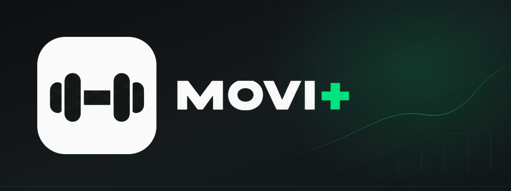

<p align="center">
  
</p>

# MOVI+

O MOVI+ é uma plataforma acadêmica que conecta praticantes e profissionais de uma academia comunitária, com foco em atividade física e acessibilidade. A aplicação reúne o cadastro de usuários, a biblioteca de exercícios, o planejamento de rotinas e o registro de treinos.

Projeto desenvolvido na disciplina Prática IV de Ciência da Computação da UNOESC, em 2026.

## Sumário

- [Funcionalidades](#funcionalidades)
- [Modelos e propostas de treino](#modelos-e-propostas-de-treino)
- [Stack](#stack)
- [Estrutura do projeto](#estrutura-do-projeto)
- [Executando com Docker](#executando-com-docker)
- [Desenvolvimento local](#desenvolvimento-local)
- [Banco de dados, migrations e seeds](#banco-de-dados-migrations-e-seeds)
- [Biblioteca de exercícios](#biblioteca-de-exercícios)
- [Testes e qualidade](#testes-e-qualidade)
- [Variáveis de ambiente](#variáveis-de-ambiente)
- [Segurança](#segurança)
- [Solução de problemas](#solução-de-problemas)
- [Equipe](#equipe)
- [Licença](#licença)
- [Perfil físico e acompanhamento profissional](#perfil-físico-e-acompanhamento-profissional)
- [Mapa muscular e análise avançada de treinamento](#mapa-muscular-e-análise-avançada-de-treinamento)

## Funcionalidades

| Situação | Recursos |
|---|---|
| Implementadas | Cadastro e login; cadastro profissional; gerenciamento de alunos e solicitações/vínculos; biblioteca pública e exercícios personalizados; pesquisa, filtros e detalhes; modelos profissionais e propostas de treino com aceite pelo aluno; criação, edição, arquivamento e restauração de rotinas; configuração de séries, repetições, cargas e descanso; execução de sessões e treinos livres; histórico paginado e estatísticas de evolução; mapa muscular e análise de treinamento por período; perfil físico, avaliações corporais, gráficos e comparação; acompanhamento profissional com permissões por categoria. |
| Parciais | A mídia aparece quando existe cadastro válido de imagem ou GIF. O descanso tem alerta visual enquanto a página está aberta. Rascunhos pendentes sobrevivem a falhas na mesma aba, mas não há sincronização offline depois de fechá-la. |
| Planejadas | Recomendações automáticas, gamificação com ranking e conquistas, espaços públicos e recursos ampliados de comunidade e acessibilidade. |

## Stack

| Camada | Tecnologia | Uso |
|---|---|---|
| Aplicação | PHP 8.3, Apache, Composer 2 | Aplicação sem framework; Composer fornece autoload PSR-4 para o namespace `App`. |
| Persistência | MySQL 8.4, PDO | Banco relacional e consultas parametrizadas. |
| Interface | HTML, CSS, JavaScript | Views PHP, estilos e interações do catálogo e dos treinos. |
| Infraestrutura | Docker, Docker Compose v2 | Execução dos serviços `app` e `db` em contêineres. |

`public/index.php` direciona método e caminho conforme [routes/web.php](routes/web.php). Controllers recebem requisições, services concentram regras, repositories consultam o banco e as views geram a interface. O Apache publica somente `public/`.

## Estrutura do projeto

```text
MOVI+/
├── .docker/php/       # Dockerfile e configurações PHP/Apache
├── app/
│   ├── Config/        # Conexão PDO
│   ├── Contracts/     # Contrato das métricas de treino
│   ├── Controllers/   # Fluxo HTTP
│   ├── Models/        # Entidades
│   ├── Repositories/  # Consultas e persistência
│   ├── Security/      # Sessão, autenticação, CSRF e limite de login
│   ├── Services/      # Regras e operações de treino
│   ├── Support/       # Validação de entradas
│   └── Views/         # Templates PHP
├── assets/            # Identidade visual do projeto
│   ├── alternatives/  # Banner e prévia social alternativos
│   ├── variants/      # Variações de tema, orientação e tamanho
│   ├── favicon.png
│   ├── movi-plus-app-icon.png
│   ├── movi-plus-banner-original.png
│   ├── movi-plus-logo-and-slogan.png
│   ├── movi-plus-logo-horizontal.png
│   ├── movi-plus-logo-mono.png
│   └── social-preview-1280x640.jpg
├── database/
│   ├── migrations/    # 001–018, evolução do schema
│   ├── scripts/       # Migrador, importação e validação do catálogo
│   └── seeds/         # 37 arquivos SQL de dados oficiais e relações
├── public/
│   ├── assets/        # CSS, JavaScript e imagens públicas
│   ├── .htaccess      # Regras de entrada do Apache
│   └── index.php      # Front controller
├── routes/            # Mapa de rotas
├── storage/           # Diretórios locais de uploads, sessões e logs
├── tests/             # Testes unitários, de integração e HTTP
├── compose.yml        # Serviços de desenvolvimento
├── composer.json      # Autoload da aplicação
└── README.md          # Documentação operacional única
```

## Executando com Docker

### Pré-requisitos

- Git.
- Docker Desktop no Windows (com WSL 2) ou no macOS. No Linux, Docker Engine com o plugin Docker Compose.
- Contêineres Linux habilitados. No Windows, confirme WSL 2 com `wsl --status` e aguarde o Docker Desktop iniciar.
- Compose v2 com suporte a `up --wait`.

PHP, MySQL e Composer no host não são necessários.

### Instalação limpa

Clone o projeto e crie o arquivo de ambiente local:

```sh
git clone https://github.com/MiguelBrugnago/MOVI-MORE.git
cd MOVI-MORE
cp .env.example .env
```

No PowerShell, use `Copy-Item .env.example .env`. Edite `.env` e troque os dois valores de exemplo por senhas locais diferentes. Mantenha `.env` privado; ele não deve ser versionado.

Suba o MySQL, instale dependências, aplique as migrations, importe o catálogo e inicie o Apache:

```sh
docker compose up -d --wait db
docker compose run --build --rm --no-deps app composer install --optimize-autoloader --no-interaction
docker compose run --rm --no-deps app php database/scripts/migrar.php
docker compose run --rm --no-deps app php database/scripts/popular_exercicios.php
docker compose up -d --wait app
docker compose ps
```

Abra [http://localhost:8080](http://localhost:8080). Crie uma conta para verificar cadastro e login, pesquise um exercício e confira seus detalhes. Em **Rotinas e treinos**, crie uma rotina, inclua um exercício e configure uma série; inicie e finalize uma sessão e confira o Histórico e Evolução.

Na primeira inicialização com um volume vazio, o MySQL cria o banco e o usuário definidos no arquivo `.env`. Apache não aplica migrations nem seeds automaticamente. O volume `movi_mysql_data` persiste mesmo quando containers são removidos.

## Desenvolvimento local

Abra a raiz do clone no VS Code por **Arquivo → Abrir Pasta**. O serviço `app` monta a pasta do projeto em `/var/www/html`, então alterações em PHP, CSS e JavaScript ficam visíveis após salvar; OPcache revalida timestamps. Para dependências Composer ou comandos PHP, use o container:

```sh
docker compose exec app php -v
docker compose exec app composer validate --no-check-publish
docker compose exec app composer check-platform-reqs
docker compose logs --tail=100 app db
```

Comandos úteis:

```sh
docker compose ps
docker compose stop                 # para sem apagar dados
docker compose up -d --wait         # retoma os serviços
docker compose logs -f app
docker compose exec db sh           # shell do container MySQL
```

Para atualizar o clone, confira suas alterações locais, obtenha as mudanças da equipe e leia as instruções de atualização de banco nesta documentação antes de executar migrations. Trabalhe em branch própria baseada na `main` atualizada, mantenha mudanças relacionadas juntas e revise `git status --short`, `git diff --check` e o diff staged antes de cada commit. Não coloque `.env`, dados de usuário ou backups nos commits.

## Banco de dados, migrations e seeds

O banco usa MySQL 8.4, `utf8mb4` e PDO. No Compose, o host de conexão da aplicação é `db` e a porta interna é `3306`; ferramentas no host acessam `127.0.0.1:3307`. O schema reúne usuários, autenticação e vínculos, catálogo/taxonomias e relações, rotinas reutilizáveis e execuções de treino.

### Histórico de migrations

O repositório possui migrations sequenciais **001–018**:

| Faixa | Conteúdo |
|---|---|
| 001–006 | Estrutura inicial, hash de senhas, tentativas e bloqueios de login, evento de limpeza e origem dos vínculos. |
| 007–009 | Histórico do catálogo: expansão de padrões/famílias e simplificação posterior que remove essas estruturas e cria índice de login. A sequência histórica é preservada. |
| 010–014 | Integridade do catálogo, unidades, códigos e reconciliação/prefixo MOVI+. |
| 015 | Rotinas e execução: séries, descanso, metas copiadas, métricas e índices. |
| 016 | Ajuste do evento de limpeza de tentativas para calcular o corte usando o relógio do MySQL. |
| 017 | Campos complementares do perfil físico e índices para avaliações/medidas. Preserva registros e estruturas anteriores. |
| 018 | Identificação dos modelos profissionais, propostas por vínculo e cópia dos exercícios e séries enviados. |

Execute o migrador pela aplicação:

```sh
docker compose run --rm --no-deps app php database/scripts/migrar.php
```

O script exige numeração contígua, adquire lock MySQL, salva cada etapa em `schema_migracao` e valida SHA-256 dos SQL com finais de linha normalizados. Um registro em `em_execucao`, checksum divergente ou histórico fora de sequência interrompe a execução. DDL do MySQL pode fazer commit implícito; depois de interrupção, confira estrutura e histórico antes de qualquer retomada. Não apague registros para forçar a execução.

Uma instalação sem histórico em schema já preenchido é recusada. A opção antiga `--adotar-instalacao` não existe mais. Para um legado já confirmado até 015, compare estrutura, eventos e catálogo com uma cópia limpa e faça backup antes de registrar a atestação:

```sh
docker compose run --rm --no-deps app php database/scripts/migrar.php --registrar-historico
```

Isso grava hashes como referência declarada pelo operador; não verifica retroativamente quais SQL foram executados. O migrador não executa migrations nesse modo e exige as 001–015 confirmadas. Legados parciais sem hashes ou anteriores à transição 009 precisam de recuperação planejada em cópia isolada.

Em uma instalação antiga, o evento `limpar_tentativas_login` pode pertencer a outra conta, como `root@localhost`. A 016 exige `DEFINER` igual à conta efetiva da aplicação. Confira `information_schema.EVENTS.DEFINER` e `SELECT CURRENT_USER()` usando a conexão do app. Se diferirem, peça a um administrador para transferir somente o evento antes da migration; confirme schema e usuário reais. Exemplo ilustrativo para schema `movi` e conta `movi_app@%`:

```sql
ALTER DEFINER = 'movi_app'@'%' EVENT movi.limpar_tentativas_login ENABLE;
```

Não conceda privilégios de sistema à conta do PHP para contornar isso.

### Seeds

Há **37 arquivos SQL** em `database/seeds/`. `popular_exercicios.php` os aplica em ordem alfabética, dentro de uma transação, e confirma que existe catálogo público ativo. As seeds estabelecem taxonomias e registros, exercícios e relações, aliases, slugs, ambientes e hierarquia muscular. Elas preservam códigos estáveis e não repetem a conversão histórica executada pela 014. Dados de contas e exercícios personalizados não são recriados pelas seeds.

Para conferir migrations e catálogo:

```sh
docker compose exec db sh -c 'mysql -u "$MYSQL_USER" -p "$MYSQL_DATABASE"'
```

```sql
SELECT arquivo, aplicada_em FROM schema_migracao ORDER BY arquivo;
SHOW TABLES;
SELECT COUNT(*) AS total,
       SUM(ativo = 1) AS ativos,
       SUM(ativo = 0) AS inativos,
       COUNT(DISTINCT codigo) AS codigos
FROM exercicio
WHERE usuario_id IS NULL;
```

`database/scripts/validar_catalogo.sql` verifica campos, taxonomias, duplicações e relações órfãs. `database/scripts/assinatura_catalogo.sql` produz assinatura SHA-256 de cada registro público e de suas relações, ignorando IDs internos e datas para permitir comparar instalações. Compare a saída completa entre origem e destino; totais iguais não provam que o catálogo é idêntico. Uma validação anterior registrou 629 exercícios públicos (623 ativos e 6 inativos); confirme novamente na instalação que está sendo verificada antes de usar esse número como resultado atual.

### Instalação existente e recuperação

Antes de atualizar banco existente, faça backup restaurável incluindo estrutura, dados e eventos; teste a restauração numa instância e schema separados. Não altere `.env` esperando que o MySQL atualize senhas já persistidas no volume. Compare o estado de migrations; não reimporte catálogo já existente sem entender o efeito das seeds. Se atualizar um legado para a 016, aplique a regra do `DEFINER` acima.

Backups podem conter dados pessoais e credenciais. Guarde-os somente em `storage/backups/`, que é ignorado pelo Git, e proteja o acesso. Uma exportação de recuperação pode ser feita assim (PowerShell 7.4+ para preservar bytes do redirecionamento):

```powershell
New-Item -ItemType Directory -Force storage/backups
docker compose exec -T db sh -c 'MYSQL_PWD="$MYSQL_ROOT_PASSWORD" mysqldump -u root --single-transaction --no-tablespaces --events --routines --triggers --hex-blob --set-gtid-purged=OFF "$MYSQL_DATABASE"' > storage/backups/movi-recuperacao.sql
```

Restaure somente em schema de recuperação numa instância MySQL separada e compare assinatura do catálogo e relações órfãs. Restaure separadamente dados personalizados e arquivos de mídia quando existirem. Mantenha o volume original até validar a recuperação. `docker compose stop` preserva os dados; `docker compose down -v` apaga o volume e os dados e não é necessário no fluxo normal.

## Biblioteca de exercícios

O catálogo combina dados oficiais versionados nas 37 seeds com registros personalizados ligados a uma conta. Para popular uma instalação limpa, conclua as migrations e execute `database/scripts/popular_exercicios.php` uma vez. Para conferir exercícios e vínculos, rode `validar_catalogo.sql`, examine as contagens por status e compare `assinatura_catalogo.sql` com uma instalação de referência.

Se a importação falhar, a transação é revertida; verifique a mensagem do primeiro SQL inválido, as migrations aplicadas e a conectividade PDO antes de tentar novamente. Não remova registros isolados nem recrie IDs manualmente para corrigir falhas: seeds posteriores resolvem vínculos por código estável. Após qualquer restauração, confira relações de exercícios, músculos, equipamentos, ambientes, aliases e mídias. Dados personalizados não fazem parte do catálogo versionado. Consulte as contagens da instalação com a consulta SQL da seção de seeds.

## Testes e qualidade

O executor `tests/executar.php` reúne os testes de métricas, perfil físico e análise de treinos. Para executar apenas as suítes unitárias, use `docker compose exec app php tests/executar.php` com a aplicação em execução.

Para incluir as suítes de integração e HTTP, use o ambiente definido em [tests/compose.yml](tests/compose.yml). Ele inicia um MySQL exclusivo com o banco `movi_treinos_teste`, armazena os dados em memória e monta o projeto para leitura. Instale antes as dependências com o comando `composer install` da seção de instalação limpa, para que o contêiner encontre `vendor/autoload.php`.

```sh
docker compose -p movi-treinos-verificacao -f tests/compose.yml up -d --build app
docker compose -p movi-treinos-verificacao -f tests/compose.yml exec app php database/scripts/migrar.php
docker compose -p movi-treinos-verificacao -f tests/compose.yml exec app php database/scripts/popular_exercicios.php
docker compose -p movi-treinos-verificacao -f tests/compose.yml exec app php tests/executar.php --integracao
docker compose -p movi-treinos-verificacao -f tests/compose.yml down
```

O executor usa o Apache do contêiner para as suítes HTTP de perfil e análise e inicia um servidor PHP na porta 8088 para a suíte de treinos. Ao encerrar o ambiente de teste, o banco em memória é descartado.

Para verificar a sintaxe do PHP em um shell Unix, execute `find app public routes database tests -name '*.php' -exec php -l {} +`. Para validar a configuração do Composer e os requisitos da plataforma, use os comandos da seção de desenvolvimento local.

## Variáveis de ambiente

| Variável | Descrição |
|---|---|
| `DB_NAME` | Schema MySQL (exemplo: `movi`). |
| `DB_USER` | Conta de aplicação com acesso ao schema; não use `root`. |
| `DB_PASSWORD` | Senha local da conta da aplicação. |
| `DB_ROOT_PASSWORD` | Senha administrativa local, distinta da senha do app. |
| `DB_HOST` | No Compose, definido como `db` para o serviço PHP. |

`.env.example` contém somente nomes e valores fictícios. A aplicação usa porta interna 3306. A publicação local do MySQL é `127.0.0.1:3307`; Apache usa `127.0.0.1:8080`. O código não consome `DB_PORT`, `APP_ENV` ou `APP_DEBUG`.

## Segurança

- Senhas de usuários são persistidas com hash; nunca são armazenadas em texto simples.
- Sessões usam cookies e configuração centralizada; autenticação e autorização são verificadas nas operações privadas.
- Formulários e POSTs de alteração usam tokens CSRF.
- PDO utiliza prepared statements para valores recebidos em consultas.
- Tentativas de login são limitadas e limpas por evento MySQL; a migration 016 ajusta o cálculo temporal.
- As credenciais são lidas de variáveis de ambiente. Não publique `.env`, backups, logs, tokens ou chaves privadas.
- `.gitignore` exclui `vendor/`, logs, uploads locais, sessões e `storage/backups/`; `.dockerignore` evita copiar credenciais e dados locais para a imagem.
- Portas Docker são vinculadas ao loopback. Esta configuração destina-se ao desenvolvimento local, não define uma implantação de produção.

## Solução de problemas

| Problema | Verificação ou correção |
|---|---|
| Docker indisponível | Inicie Docker Desktop, confira WSL 2 no Windows e use `docker version` e `docker compose version`; a saída do servidor precisa estar disponível. |
| MySQL não inicializa | Consulte `docker compose logs --tail=100 db`; confira as quatro variáveis e aguarde o healthcheck. |
| Composer não encontrado | Composer é executado no container PHP: use o comando `docker compose run ... app composer install` da instalação. |
| Falta `vendor/autoload.php` | Execute `composer install` no container com o volume do projeto montado e confirme acesso de escrita à pasta clonada. |
| Erro de conexão PDO/acesso negado | Confirme host `db`, schema e credenciais. Alterar `.env` não substitui as credenciais gravadas num volume já inicializado. |
| Migration pendente ou tabela inexistente | Aguarde MySQL saudável, execute `migrar.php`, depois seeds, e confira `schema_migracao`. Não force uma migration interrompida sem comparar o schema. |
| Erro na migration 016 | Compare o `DEFINER` de `limpar_tentativas_login` com `CURRENT_USER()` e siga a instrução específica acima. |
| Porta 8080 ou 3307 ocupada | Libere a porta ou altere a porta à esquerda do mapeamento em `compose.yml`; preserve 80 e 3306 no container. |
| Problemas com volume | Faça backup e ensaie em cópia. `stop` mantém o volume; `down -v` o apaga. Senhas no `.env` não reconfiguram volume existente. |
| Instalação em outro computador falha | Refaça `.env` de `.env.example`, use Docker com Compose v2, instale dependências, aplique migrations e seeds na ordem indicada e confira logs. Não copie `vendor/` ou `.env` de outra máquina. |

## Equipe

- Eduardo Blank
- Bernardo D. Schmietke
- Miguel H. H. Brugnago

Ciência da Computação — UNOESC · Prática IV · 2026.

- [Apresentação do projeto no Canva](https://canva.link/e9a80l6m8j3afdz)
- [Planejamento no Notion](https://app.notion.com/p/MOVI-ACADEMIA-COMUNITARIA-3e9a22d7a49f80b39f34ed7cefacf41a?source=copy_link)

## Licença

O repositório não contém arquivo de licença. Portanto, não há uma licença de software declarada; consulte os autores antes de reutilizar ou redistribuir o projeto.

## Perfil físico e acompanhamento profissional

### Auditoria e decisões de integração

A estrutura anterior já continha `usuario.data_nascimento`, `perfil` (gênero, objetivo, experiência, frequência e biografia), `avaliacao`, `medida`, `condicao`, `usuario_condicao`, `restricao`, `usuario_restricao`, `meta`, `permissao_acesso` e `auditoria_acesso`. Não havia fluxo de perfil/avaliações nem uso das permissões nas telas de acompanhamento. O vínculo e a autenticação existentes foram reutilizados. `Auth::usuario()` valida sessão e conta ativa; os IDs de proprietário vêm exclusivamente da sessão. O layout comum e os estilos de cartões/formulários foram mantidos.

A migration **017**, dependente de 001–016, acrescenta somente `perfil.altura_cm`, `tempo_treinamento_meses`, `disponibilidade`, `ambiente_preferido` e dois índices. Não duplica peso, gordura, massa magra, metas ou condições. As migrations anteriores permanecem intactas. Nutrição, gamificação e mapa muscular continuam fora desta etapa.

### Uso

- **Perfil físico** (`/perfil`): dados opcionais, objetivo esportivo, disponibilidade e informações voluntárias de condições/restrições. Peso e gordura são apresentados a partir da avaliação mais recente; o botão **Registrar peso e medidas** cria um registro histórico.
- **Avaliações** (`/perfil/avaliacoes`): nova avaliação, detalhes, correção e exclusão confirmada. Cada cadastro gera uma avaliação independente, inclusive na mesma data. A data usa o calendário de São Paulo. Campos numéricos aceitam até três casas decimais; na interface, o navegador apresenta o separador conforme o idioma.
- **Evolução corporal** (`/perfil/evolucao`): 30 dias, 90 dias, seis meses, um ano ou histórico completo; gráficos SVG locais e comparação entre quaisquer duas avaliações do período. Tabelas mantêm os valores acessíveis sem JavaScript. Variação de gordura é expressa em pontos percentuais.
- **Meus vínculos**: o aluno autoriza/revoga separadamente perfil/medidas (`fisico`), condições/restrições/observações (`saude`) e histórico/estatísticas de treino (`treinos`). Todas as categorias começam bloqueadas. Uma nova solicitação após encerramento exige novas autorizações.
- **Meus alunos → Acompanhamento**: profissional ativo, conta ativa e vínculo ativo são obrigatórios. Cada categoria exige consentimento; o acesso é somente leitura e registra recurso/ação em `auditoria_acesso`, sem copiar dados de saúde ao log. Histórico de treinos reutiliza a paginação e as estatísticas existentes.

As medidas usam `medida.tipo` = `peso`, `gordura`, `braco`, `antebraco`, `torax`, `cintura`, `abdomen`, `quadril`, `coxa`, `panturrilha`, com unidades `kg`, `%` ou `cm`. A massa gorda e a massa magra são **estimativas calculadas**, nunca medidas clínicas, e usam exclusivamente peso e gordura da mesma avaliação. Valores ausentes não são zero. Tipos legados desconhecidos são preservados ao corrigir uma avaliação, mas não interpretados nos gráficos. Avaliações com `profissional_id` preenchido permanecem somente para consulta.

Os nomes de condições/restrições reutilizam os catálogos existentes, sem expor um catálogo global de declarações na interface. Observações privadas de restrição ficam em `usuario_restricao.observacao`; observações pessoais usam `perfil.biografia`. As permissões físicas não expõem esses textos nem as observações das avaliações.

### Aplicação da atualização

Na instalação de desenvolvimento, com backup restaurável e histórico 001–016 conferido:

```sh
docker compose exec app composer install --no-interaction
docker compose exec app php database/scripts/migrar.php
```

O migrador aplica apenas a 017 pendente e verifica os hashes anteriores. Não é necessário reiniciar o banco, reimportar seeds ou remover volumes. Não execute em produção sem um processo próprio de implantação. Para instalação limpa, siga a sequência Docker descrita acima.

### Testes desta etapa

No ambiente isolado com `DB_NAME=movi_treinos_teste`, execute:

```sh
php tests/perfil_unitario.php
php tests/perfil_http.php
php tests/treinos_integracao.php
```

`perfil_unitario.php` não acessa o banco. `perfil_http.php` requer a aplicação servida por Apache em `http://127.0.0.1:80` no mesmo container; cria exclusivamente contas sintéticas e se recusa a rodar fora do schema de testes. Cobre CRUD, manutenção do histórico, cálculos, datas, entradas malformadas, CSRF, XSS, IDs de outras contas, leitura profissional, permissões independentes, revogação e renovação de vínculo. Para incluir a regressão HTTP de treinos, use o executor com `--integracao`, conforme a seção de testes.

A verificação desta implementação usou um projeto Compose separado (`movi-perfil-verificacao`), MySQL 8.4 próprio e aplicação na porta local 8089, sem alterar os containers/banco preexistentes. As migrations 001–017, seeds, testes de perfil e regressões de treinos foram executados nesse ambiente. O teste de cadastro da suíte anterior foi atualizado para enviar `confirmar_senha`, campo já obrigatório no controller.

## Mapa muscular e análise avançada de treinamento

### Entrega e auditoria — 18/11/2026

Implementados mapa frontal/posterior, detalhes por músculo, séries diretas/indiretas/equivalentes, volume externo separado por exercício e lado, distribuição por grupo, frequência semanal, progressão de carga, melhores cargas por quantidade exata de repetições, evolução de recordes e comparação com o período anterior. Os gráficos usam `meter` nativo com rótulos e valores; os dados e detalhes permanecem consultáveis sem JavaScript. JavaScript abre o detalhe ao selecionar o SVG, inclusive por teclado. Não há dependência externa de gráficos ou framework.

A auditoria encontrou as estruturas necessárias nas migrations 001–017: `musculo` (código, `svg_id` e hierarquia), `exercicio_musculo` (papel e `peso_estimado`), `grupo_muscular`, `tipo_registro`, `treino`, `treino_exercicio` e `serie`. A persistência da análise usa repositórios. Os modelos de treino e exercício ficam em `app/Models/`. As estatísticas anteriores e seus fluxos foram preservados. Autenticação, consentimento `treinos`, vínculo ativo, conta/profissional ativos e auditoria de leitura reutilizam as classes existentes.

As seeds não documentam uma semântica numérica para `peso_estimado`; as relações consultadas no banco legado usam NULL. Não foi reinterpretado esse campo nem alterada a classificação do catálogo. Exercícios personalizados sem associação muscular aparecem no diagnóstico de qualidade de dados e nos totais, sem receber músculos inventados.

**Banco local preexistente:** a consulta encontrou um schema legado sem `schema_migracao`, `tipo_registro`, `musculo.codigo` e `serie.ignorada`. Ele não corresponde à versão atual do repositório. Nenhum dado, seed ou migration foi aplicado nesse banco. A aplicação atual já depende das estruturas ausentes; as novas análises retornam uma mensagem genérica de indisponibilidade quando a consulta não pode ser realizada. A validação funcional ocorreu exclusivamente em outro MySQL, no projeto Compose `movi-analise-verificacao`, com `DB_NAME=movi_treinos_teste` e app em `127.0.0.1:8091`.

### Navegação e acesso

| Rota GET | Uso |
|---|---|
| `/treinos/analise` | Painel completo de análise. |
| `/treinos/mapa-muscular` | Mesmo painel, usado pela navegação para a seção `#mapa`. |
| `/treinos/progressao` | Mesmo painel, usado pela navegação para `#progressao`. |

O painel do aluno e a navegação de treinos oferecem acesso. Em **Meus alunos → Acompanhamento**, o link aparece somente com consentimento para treinos. As três rotas aceitam `aluno=ID`, mas verificam novamente a autorização no servidor, antes de consultar qualquer treino; mudar o ID ou a rota não contorna a permissão. A consulta profissional registra `analise_muscular` em `auditoria_acesso` e não permite editar os dados. As respostas são privadas e `no-store`.

Filtros: `periodo=7|30|90|semana|personalizado`, `de`/`ate` em `YYYY-MM-DD`, `metrica=equivalentes|series|diretas|indiretas` e `exercicio=ID`. Intervalos personalizados são inclusivos, limitados a 366 dias, sem datas futuras. Consultas SQL usam início inclusivo e fim exclusivo, convertendo os limites de São Paulo com `FROM_UNIXTIME`. IDs, arrays indevidos e filtros inválidos recebem 422; acesso sem consentimento recebe 403; sem sessão, redirecionamento ao login.

### Regras de cálculo

- **Elegibilidade:** treino `concluido`, série `concluida=1`, `ignorada=0`, excluindo `aquecimento` e `preparatoria`. Tipo NULL segue a regra existente de série normal. Sessões canceladas, excluídas ou em andamento nunca entram. Sessões concluídas sem séries de trabalho contam na frequência, mas não no estímulo.
- **Séries registradas:** contagem das séries elegíveis por músculo associado. Uma série multiarticular pode aparecer em vários músculos, mas conta apenas uma vez no total geral e no grupo principal cadastrado do exercício.
- **Diretas/indiretas:** contagens correspondentes a `primario` e `secundario`. `estabilizador` fica separado. São estimativas baseadas no catálogo, não comprovação de recrutamento individual.
- **Séries equivalentes:** soma de séries × fator heurístico: primário **1**, secundário **0,5**, estabilizador **0**. Constantes em `AnaliseTreinoService::FATORES`. Fatores não são percentuais de carga e não são normalizados entre músculos. `peso_estimado` preenchido ou papel desconhecido aparece na lista de revisão; nenhum valor do catálogo é reescrito. Pais e filhos não são somados automaticamente.
- **Volume externo:** soma de carga × repetições apenas para natureza `externa`, unidade `repetições`, carga não negativa e repetições positivas. Carga ausente não vira zero. Assistência, peso corporal, carga adicional e contagens de passos/andares não são misturados nesse volume. A atribuição por músculo multiplica pelo fator acima. O painel mantém resultados por exercício/lado, sem produzir um total indiscriminado entre aparelhos e modalidades ou duplicar a carga de exercícios unilaterais.
- **Frequência:** sessões/semana = sessões × 7 ÷ dias do intervalo; dias/semana = dias distintos com sessão × 7 ÷ dias. Por músculo, usa dias distintos com série associada. Semanas são ISO em São Paulo; as extremidades podem ser parciais. O tempo soma duração de sessão, incluindo descanso.
- **Comparação:** intervalos adjacentes com a mesma quantidade de dias. Para semana atual, compara os mesmos dias da semana anterior. Variação absoluta = atual − anterior; percentual = diferença ÷ anterior × 100, apenas quando ambos existem e anterior não é zero. Ausência permanece `—`/não aplicável.
- **Progressão e recordes:** maiores cargas por sessão e lado; a série detalhada conserva carga e contagem juntas. Melhores cargas por número exato de repetições não são estimativas de 1RM. Novos recordes são comparados ao máximo de todo o histórico anterior ao intervalo, incluindo empates (que não criam recorde). Carga adicional é identificada como tal; assistência é excluída dos recordes de carga. A tabela detalhada exibe as 500 séries mais recentes com aviso; agregações, melhores marcas e gráficos abrangem todo o período.
- **Cores:** 0 neutro; acima de 0 e abaixo de 5; 5 a menos de 10; 10 a menos de 20; 20 ou mais. Limites configuráveis em `AnaliseTreinoService::FAIXAS`, utilizados também pela legenda. Aplicam-se à métrica selecionada no intervalo, não a metas fisiológicas.

### SVG, origem e correspondência

Não havia SVG corporal no repositório. O novo desenho é original desta implementação, composto de polígonos em `MapaMuscular.php` e renderizado inline pela view, sem ilustrações copiadas ou bibliotecas de terceiros. É um esquema geométrico, não um atlas anatômico: músculos profundos usam faixas e a legenda informa essa limitação. As duas metades representam o mesmo músculo, sem inferir lateralidade do estímulo.

`musculo.svg_id` é usado quando corresponde a uma chave conhecida do desenho; quando vazio/desconhecido, usa-se `musculo.codigo`. Isso permite integrar instalações e reimportações de seeds sem editar dados históricos ou preencher campos que as seeds atuais voltariam a esvaziar. Os 52 códigos do catálogo de teste possuem correspondência individual; deltoides e trapézios mantêm suas porções. Romboides não existem como músculo nesse catálogo e não foram inventados. Músculos adicionados futuramente sem desenho continuam consultáveis na lista e são identificados como sem região SVG.

O agrupamento visual em `MapaMuscular` organiza a anatomia quando `musculo.grupo` está vazio; ele não modifica o grupo principal de exercícios no banco. SVG, legenda, lista de músculos e detalhes usam as mesmas métricas. Cores não indicam crescimento, recuperação nem diagnóstico clínico. As regiões são links com nomes acessíveis; os detalhes usam elementos `details/summary`, oferecendo alternativa aos pequenos alvos do desenho em celulares.

### Arquivos desta etapa

Criados:

- `app/Controllers/AnaliseTreinoController.php` — autorização, filtros e montagem da resposta.
- `app/Repositories/AnaliseTreinoRepository.php` — agregações por sessão/exercício/lado, catálogo, relações e progressão.
- `app/Services/AnaliseTreinoService.php` — períodos, cálculos, comparações e níveis de cor.
- `app/Services/MapaMuscular.php` — desenho original e correspondência por código.
- `app/Views/treino_analise.php` — mapa, filtros, gráficos e tabelas.
- `public/assets/css/analise.css` — estilos restritos ao novo painel, sem reescrever o layout global.
- `public/assets/js/analise.js` — seleção acessível das regiões.
- `tests/analise_unitario.php`, `tests/analise_integracao.php`, `tests/analise_http.php` — testes permanentes.

Modificados: `routes/web.php`, `app/Views/treinos/comum.php`, `app/Views/painel_aluno.php`, `app/Views/aluno_detalhes.php` e este `README.md`.

**Migrations novas: nenhuma.** No ambiente isolado foram executadas as migrations existentes 001–017 e as 37 seeds. O índice existente `ix_treino_historico (usuario_id,status,finalizado_em,id)` atende ao filtro; EXPLAIN confirmou acesso `range`. Consultas não variam com a quantidade de músculos: relações são buscadas em lote e séries são agregadas no SQL antes do cálculo muscular. Somente a consulta de máximo anterior consulta o histórico além dos limites, retornando um agregado por lado.

### Testes executados e resultados

Todos os comandos abaixo foram executados com sucesso no ambiente isolado:

```sh
php tests/analise_unitario.php
php tests/analise_integracao.php
php tests/analise_http.php
php tests/perfil_unitario.php
php tests/perfil_http.php
php tests/treinos_integracao.php
# Com servidor PHP de teste já iniciado em 127.0.0.1:8088:
php tests/treinos_http.php
```

Os testes de integração/HTTP recusam bancos diferentes de `movi_treinos_teste`. Prepare o ambiente isolado conforme a seção de testes anterior, com migrations e seeds, antes de executá-los. A suíte de análise HTTP exige Apache no mesmo container em `127.0.0.1:80`. A integração de análise usa transação e rollback; os testes HTTP criam apenas contas sintéticas no banco de teste.

Cobertura nova: estado vazio; uma/várias sessões; multiarticular; músculo sem série; exercício sem relação; correspondência de todos os códigos SVG; datas inválidas e limites de dia; diretas/indiretas/equivalentes; cores e limites; carga ausente; aquecimento/preparatórias/ignoradas/pendentes; treino cancelado/excluído/aberto; unidade de passos; assistência e carga adicional; comparação e divisão por zero; recordes anteriores; proprietário; XSS; autenticação; profissional sem vínculo; consentimento de outra categoria; autorização; revogação; vínculo encerrado; profissional e aluno inativos; auditoria de leitura.

Regressões executadas: cadastro, login e limite de tentativas; profissionais/vínculos; rotinas; séries; finalização; histórico e estatísticas; perfil físico; avaliações e acompanhamento. Nenhuma falha foi observada nessas suítes. PHP lint de `app`, `public`, `routes`, `database` e `tests` passou; `node --check public/assets/js/analise.js` e `git diff --check` passaram. Composer validou os manifests, com o aviso preexistente de licença não especificada; não foram adicionadas dependências.

No navegador: seleção por Enter e clique em região abre os detalhes; layout conferido em 390×844 e 1280×900; sem transbordamento horizontal do documento no tamanho móvel e sem erros JavaScript observados. A conferência visual identificou contraste insuficiente na primeira versão dos detalhes; corrigido com tema grafite/verde restrito ao painel. Toque físico em aparelho real e auditoria completa com leitor de tela não foram executados.

Medições locais (não são garantia de carga de produção): nova integração com fixtures e regras de modalidade em aproximadamente 48 ms; cálculo sobre o usuário da regressão com 1.002 sessões no intervalo e 2 linhas agregadas de exercícios em 21,5 ms. O teste de regressão também gravou 150 séries. Esse cenário não substitui benchmark com milhares de sessões densas.

### Pendências e continuidade

A implementação foi validada no esquema atual, mas o banco de desenvolvimento principal precisa de reconciliação antes do uso local completo. Não execute as migrations históricas indiscriminadamente nesse legado: o migrador recusa schema preenchido sem histórico e existem mudanças históricas de catálogo. Faça backup restaurável, ensaie a atualização em cópia, compare estrutura e catálogo e resolva o histórico conforme a seção de recuperação. Nenhuma adoção fictícia de migrations foi feita nesta etapa.

Limitações intencionais: estimativa por heurística; ausência de semântica confiável para `peso_estimado`; SVG esquemático; relações musculares sem lado; sem recomendação automática de volume ou 1RM. Nutrição e gamificação não foram implementadas. Próximos passos recomendados: reconciliar o banco legado, revisar fatores com profissionais e documentar sua fonte, aprimorar o desenho anatômico e testar toque/leitores de tela, além de medir desempenho com históricos densos antes de considerar cache.

## Modelos e propostas de treino

1. No painel profissional, abra **Gerenciar modelos de treino**. Crie um modelo, informe o objetivo e use o editor para organizar exercícios do catálogo público, séries, metas, grupos e descanso. O editor também permite duplicar, arquivar e restaurar modelos. A opção **Criar modelo a partir de uma rotina minha** também aceita rotinas pessoais cujos exercícios estejam ativos no catálogo público.
2. Abra o modelo ativo, selecione um aluno vinculado e clique em **Enviar proposta**. O profissional pode acompanhar as pendências, cancelar um envio e consultar o histórico de cada aluno.
3. No painel do aluno, abra **Propostas de treino recebidas** para conferir o profissional, os exercícios e cada série. Aceitar cria uma rotina pessoal com a identificação do profissional. Recusar encerra a proposta e mantém o conteúdo disponível no histórico.
4. A rotina aceita aparece em **Meus treinos**. O aluno pode editá-la e iniciar sessões pelo fluxo habitual, inclusive após o encerramento do vínculo.

### Rotas do módulo

| Método | Caminho | Uso |
|---|---|---|
| GET | `/profissional/modelos` | Lista e editor. Aceita `id` e `arquivadas=1`. |
| POST | `/profissional/modelos/salvar` | Criação, edição, ordenação, duplicação, arquivamento e restauração pelo proprietário. |
| POST | `/profissional/propostas/enviar` | Envio de um modelo ativo ao aluno selecionado. |
| GET | `/profissional/propostas` | Enviadas. Aceita `id` para detalhes, `aluno` para histórico e `pendentes=1` para filtrar. |
| GET | `/propostas` | Recebidas pelo usuário autenticado. Aceita `id` e `pendentes=1`. |
| POST | `/propostas/responder` | Aceite ou recusa pelo destinatário e cancelamento pelo remetente. |

### Banco, autorização e orientação a objetos

A migration **018_propostas_rotina.sql** acrescenta `rotina.modelo_profissional`, com valor inicial falso para as rotinas existentes. A tabela `proposta_rotina` guarda o vínculo, o modelo, a versão enviada do nome, objetivo, descrição e dia, o estado e a referência à rotina aceita. Cada registro de `proposta_exercicio` mantém a referência ao exercício, o nome exibido no envio e as suas séries em JSON. As chaves estrangeiras preservam essas referências. Os índices únicos permitem várias propostas encerradas do mesmo modelo e uma pendente por vínculo.

O servidor confere a conta, o perfil profissional e o vínculo ativo para enviar. O catálogo do editor profissional contém exercícios públicos ativos, utilizáveis por todos os destinatários. No aceite, o serviço confere o vínculo, o destinatário e a disponibilidade dos exercícios novamente. Se um exercício sair do catálogo nesse intervalo, o aluno ainda pode revisar ou recusar o envio. Encerrar o vínculo cancela as pendências na mesma transação. Reabrir o vínculo permite novos envios. O acesso a histórico, perfil físico e saúde continua dependendo do consentimento específico para cada categoria.

Na camada de aplicação, `RotinaController` recebe os formulários e reutiliza a validação de sessão e CSRF. `TreinoService` aplica ao modelo as mesmas regras de exercícios, séries e ordenação da rotina pessoal. `PropostaService` usa composição com `PropostaRepository` e `TreinoRepository`. O primeiro consulta propostas de cada participante. O segundo fornece a transação e a cópia do planejamento, também usada ao duplicar uma rotina. Bloquear a proposta durante o aceite faz dois pedidos simultâneos convergirem para a mesma rotina do aluno. Novas sessões continuam sob responsabilidade de `TreinoService`.

### Execução e testes

Para instalar, siga a seção **Executando com Docker**. Em instalações já acompanhadas pelo migrador, aplique a 018 antes de servir a nova versão do PHP. Para reproduzir a verificação em um ambiente isolado novo com as dependências do Composer instaladas, execute:

```sh
docker compose -p movi-propostas-verificacao -f tests/compose.yml up -d --build app
docker compose -p movi-propostas-verificacao -f tests/compose.yml exec -T app php database/scripts/migrar.php
docker compose -p movi-propostas-verificacao -f tests/compose.yml exec -T app php database/scripts/popular_exercicios.php
docker compose -p movi-propostas-verificacao -f tests/compose.yml exec -T app php tests/executar.php --integracao
```

A suíte `propostas_integracao.php` cobre alteração do modelo após envio, aceite, recusa, cancelamento, vínculos encerrados e reabertos, isolamento entre contas, reenvios e cópia de metas. Ela provoca uma falha na segunda série para verificar que o MySQL desfaz a cópia inteira. A suíte `treinos_http.php` cobre o editor, os formulários, a proteção CSRF, a exibição de texto escapado e o acesso à rotina aceita. O executor também inclui as regressões de treinos, perfil e análise.

Na verificação desta entrega, as 18 migrations e as 37 seeds rodaram em um MySQL 8.4 isolado e as 11 suítes passaram. A consulta ao banco principal mostrou a 016 como última migration registrada. Nesse banco, as migrations pendentes para esta versão são a 017 e a 018.

A consulta de propostas oferece filtros de aluno e estado. Ela carrega todos os registros correspondentes. Para históricos extensos, a próxima melhoria sugerida é paginar a lista.

### Arquivos da implementação

| Área | Criados | Modificados |
|---|---|---|
| Regras e persistência | `app/Services/PropostaService.php`, `app/Repositories/PropostaRepository.php` | `app/Services/TreinoService.php`, `app/Repositories/TreinoRepository.php`, `ExercicioRepository.php` e `VinculoProfissionalRepository.php` no mesmo diretório de repositórios |
| HTTP e navegação | `app/Views/propostas.php` | `routes/web.php`, `app/Controllers/RotinaController.php` e, em `app/Views/`, `rotinas.php`, `treino_seletor.php`, `treinos/comum.php`, `painel_profissional.php`, `painel_aluno.php` e `aluno_detalhes.php` |
| Banco e testes | `database/migrations/018_propostas_rotina.sql`, `tests/propostas_integracao.php` | `tests/executar.php`, `tests/treinos_http.php` |
| Documentação | | `README.md` |
