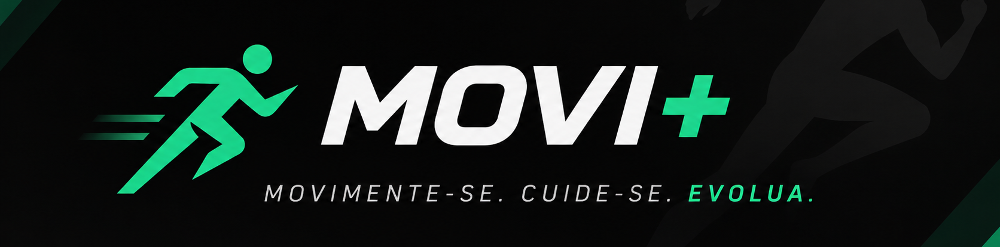

**Uma plataforma digital que conecta atividade física, acessibilidade, comunidade e oportunidades profissionais.**

---

## Sobre o projeto

O **MOVI+** é um projeto acadêmico que propõe incentivar a prática de atividade física de forma acessível, personalizada e motivadora, conectando pessoas, espaços e oportunidades em um único ecossistema.

## Objetivo

Promover hábitos saudáveis e ampliar o acesso à atividade física, aproximando pessoas de espaços públicos, atividades e profissionais, com foco na inclusão, participação e evolução pessoal.

## Funcionalidades planejadas

- Treinos e sugestões de atividades personalizadas.
- Adaptações para ampliar a acessibilidade.
- Comunidade e incentivo à participação.
- Gamificação com pontos, níveis, rankings e conquistas.
- Descoberta e valorização de espaços públicos para atividade física.
- Conexão entre usuários e profissionais da área.

> **Status:** Projeto acadêmico em desenvolvimento. As funcionalidades listadas representam objetivos planejados e ainda não necessariamente implementados.

## Equipe

- Eduardo Blank
- Bernardo D. Schmietke
- Miguel H. H. Brugnago

## Documentação

- 📊 **Apresentação do Projeto:** [Acessar apresentação no Canva](https://canva.link/h84recrwu6q3xu5)
- 📝 **Planejamento no Notion:** [Acessar planejamento no Notion](https://app.notion.com/p/MOVI-ACADEMIA-COMUNITARIA-3e9a22d7a49f80b39f34ed7cefacf41a?source=copy_link)

## Contexto acadêmico

**Curso:** Ciência da Computação — UNOESC

**Componente:** Prática IV

**Ano:** 2026

---

**MOVI+** · Movimente-se. Cuide-se. Evolua.

